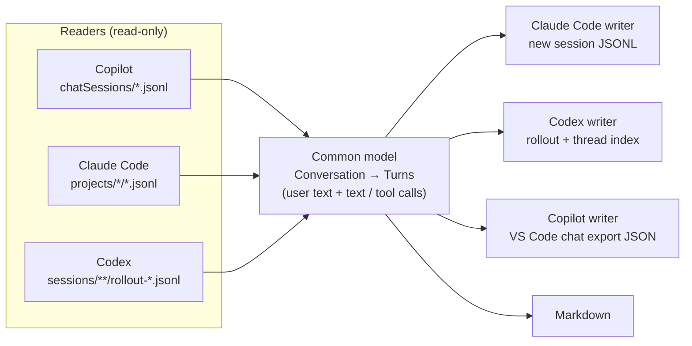

# DAFO Chat Bridge

**Move a conversation from one AI coding agent to another and keep working where you left off.**

DAFO Chat Bridge reads the local chat history of **GitHub Copilot Chat (VS Code)**, **Claude Code** and **OpenAI Codex**. It converts a conversation into a common format and writes it into another agent's own history, so you can continue it there. Everything happens on your machine, with no network calls.

- Started a task with Copilot and want Claude Code to finish it? Send the chat to Claude Code.
- Codex ran out of credits in the middle of a session? Continue it in Copilot.
- Want to archive or share a long agent session? Export it to Markdown.

It ships as a **VS Code extension** (sidebar, `@bridge` chat participant, status-bar button) and as a **command-line tool** (`chat-bridge`). The extension bundles the CLI.

---

## Contents

- [What it supports](#what-it-supports)
- [Quick start](#quick-start)
- [Using the VS Code extension](#using-the-vs-code-extension)
- [Using the CLI](#using-the-cli)
- [How it works](#how-it-works)
- [What is carried over](#what-is-carried-over)
- [Where the data lives](#where-the-data-lives)
- [Safety and privacy](#safety-and-privacy)
- [Compatibility](#compatibility)
- [Troubleshooting](#troubleshooting)
- [Development](#development)

---

## What it supports

| From ↓ / To → | Copilot Chat | Claude Code | Codex | Markdown |
|---|:-:|:-:|:-:|:-:|
| **Copilot Chat** | ✓ (another workspace) | ✓ | ✓ | ✓ |
| **Claude Code** | ✓ | – | ✓ | ✓ |
| **Codex** | ✓ | ✓ | – | ✓ |

Each migrated conversation becomes a **new session** in the destination. It shows up in that agent's normal history and can be resumed like any other session. The original is never modified.

## Quick start

Requirements: **Python 3.9+**. To build the extension you also need **Node.js 18+**. At least one of the agents must be installed.

```bash
git clone https://github.com/gabgiani/dafo-chat-bridge.git
cd dafo-chat-bridge

# VS Code extension (includes the CLI)
cd vscode-extension
npm install
npm run package                      # -> dafo-chat-bridge.vsix
code --install-extension dafo-chat-bridge.vsix

# Optional: the CLI on your PATH
cd ..
pipx install .                       # or: pip install --user .   (or run ./chat-bridge directly)
chat-bridge list
```

## Using the VS Code extension

### Sidebar

Open the **DAFO Chat Bridge** icon in the activity bar. Conversations are grouped by agent: Copilot, Claude Code and Codex.

- **Click** a conversation to open it as Markdown.
- **⇄ Pass to…** (inline button or right click) asks for a destination: Claude Code, Codex, Copilot or Markdown. It migrates the chat and opens it in that agent.
- **History button** in the view title passes the *latest* conversation of an agent in one step.
- **Filter button** switches between *this workspace only* (the default) and *all conversations*.

### From the Copilot chat: `@bridge`

Inside any Copilot Chat conversation, type:

| Command | Effect |
|---|---|
| `@bridge /claude` | Continue **this conversation** in Claude Code (opens it in the Claude panel) |
| `@bridge /codex` | Continue **this conversation** in Codex (opens the thread in the Codex panel) |
| `@bridge /markdown` | Export **this conversation** to a Markdown file |

The `@bridge` request itself is not included in the migrated conversation.

### Status bar

The **⇄ Bridge** button runs the same "pass a conversation to…" flow from anywhere.

### Settings

| Setting | Default | Description |
|---|---|---|
| `chatBridge.toolOutput` | `500` | Tool output kept per tool call: a number of characters, `full`, `0` (commands only) or `none` (no tool calls) |
| `chatBridge.lastTurns` | `0` | Migrate only the last N turns (`0` = all). Useful for very long sessions |
| `chatBridge.onlyCurrentWorkspace` | `true` | List only conversations whose working directory is inside the open workspace |
| `chatBridge.targetCwd` | `workspace` | `workspace`: the migrated session belongs to the current workspace folder, so it appears in this window's agent panels. `source`: keep the original working directory |
| `chatBridge.python` | *(empty)* | Python interpreter for the bundled CLI. Empty means `python3` (`python` on Windows) |

> The extension UI is currently in Spanish. The CLI output too.

## Using the CLI

```bash
chat-bridge list [--source copilot|claude|codex] [--cwd DIR] [--search TEXT] [--limit N] [--json]
chat-bridge show <source> <id> [--tool-output N|full|none] [--last N]
chat-bridge export <source> <id> --to claude|codex|copilot|md
                   [--cwd DIR] [--title TITLE] [--last N] [--tool-output N|full|none] [--out FILE] [--json]
```

`<id>` can be a unique prefix. For Copilot it can also be the path to the session file.

Examples:

```bash
chat-bridge list --cwd . --limit 10                       # conversations of this project, newest first
chat-bridge show copilot 1a2b3c4d | less                  # read a Copilot chat as Markdown
chat-bridge export copilot 1a2b3c4d --to claude           # -> claude --resume <new-id>
chat-bridge export claude 5e6f7a8b --to codex --last 30   # last 30 turns -> codex resume <new-id>
chat-bridge export codex 9c0d1e2f --to copilot            # -> file for "Chat: Import Chat..."
chat-bridge export codex 9c0d1e2f --to md --out chat.md
```

| Destination | What you get | How to continue |
|---|---|---|
| `claude` | New Claude Code session | `claude --resume <id>` from the target directory, or the Claude Code session history |
| `codex` | New Codex thread | `codex resume <id>`, or the Codex panel/app history |
| `copilot` | `~/.chat-bridge/exports/<title>.copilot.json` | VS Code → *Chat: Import Chat...* (the extension does this automatically) |
| `md` | `~/.chat-bridge/exports/<title>.md` | Read it, share it, or attach it to any agent |

## How it works



### 1. Reading

Each agent stores its history differently. DAFO Chat Bridge reads it directly.

- **Copilot Chat.** VS Code keeps each chat in `workspaceStorage/<hash>/chatSessions/<id>.jsonl` as an **operation log**: a snapshot followed by *set*, *push* and *delete* operations. The reader replays the log to rebuild the session. Titles come from the chat index in `state.vscdb` (opened read-only). Each tool invocation turns into a tool call: terminal commands with their output, file reads, searches and MCP tools with their results. Edits become `edit <file>`.
- **Claude Code.** Sessions are JSONL files in `~/.claude/projects/<encoded-cwd>/`. User and assistant messages are read in order. Sub-agent (side-chain) traffic, meta messages and compaction summaries are skipped. Each `tool_use` is paired with its `tool_result`.
- **Codex.** Threads are "rollout" JSONL files in `~/.codex/sessions/YYYY/MM/DD/`. The reader uses the `response_item` records: user and assistant messages, function and custom tool calls, and their outputs. It filters out the context that Codex injects (environment, `AGENTS.md`, IDE context). Titles come from the thread index (`state_N.sqlite`, opened read-only).

All three become one **common model**. A conversation is a list of **turns**. Each turn has the user message and an ordered list of assistant **parts**, which are either text or tool calls (name, command/detail, output).

### 2. Writing

The destination receives the conversation as text. Each turn becomes a user message and an assistant message. In the assistant message the agent's text is interleaved with the tool calls, rendered like this:

````
`[run_in_terminal]` cargo build --bins
```
Finished `dev` profile …
```
````

- **Claude Code.** A new `<uuid>.jsonl` is created in `projects/<encoded target dir>/` with a title entry followed by alternating user and assistant entries, linked by `parentUuid`. Assistant entries are marked as synthetic. Claude Code lists the session for that directory and can resume it.
- **Codex.** A rollout file is written in the classic format (`session_meta` plus messages). The thread is registered in Codex's thread index, copying sandbox, approval and model settings from your most recent thread. Then Codex's own **`codex migrate-rollouts --thread <id> --apply`** converts it to Codex's current history format. Finally the thread name is added to `session_index.jsonl`.
- **Copilot Chat.** A JSON file is generated in VS Code's own chat export format. VS Code imports it with the built-in **Chat: Import Chat...** command, which the extension calls for you. The imported chat then belongs to the open workspace.
- **Markdown.** A readable transcript with metadata, one section per turn.

### 3. `@bridge`: finding the active Copilot conversation

The VS Code chat API does not tell a participant which session it is running in. When you send `@bridge /claude`, VS Code saves that request in the session file for the current workspace. The extension looks in this workspace's storage for the conversation whose **last request was sent to `@bridge`** within the last minute. That conversation is migrated, without the `@bridge` requests.

## What is carried over

| Carried over | Not carried over |
|---|---|
| User messages | Images and binary attachments (replaced by `[imagen adjunta]`) |
| Assistant answers | Hidden reasoning/thinking |
| Tool calls: name, command or target, output (truncated by default, configurable) | The tool calls as *real* tool calls: the destination sees them as text |
| Order of the conversation, original timestamps (Claude Code) | Pending edits, checkpoints, undo stops, file snapshots |
| A title: `<original title> (desde <agent>)` | Agent-specific state (todo lists, model settings, MCP state) |

Long agent sessions can be large. Use `--last N` or `chatBridge.lastTurns` to send only the recent part, and `--tool-output 0` to keep only the commands.

## Where the data lives

| | macOS | Linux | Windows | Override |
|---|---|---|---|---|
| VS Code (`User`) | `~/Library/Application Support/Code/User` | `~/.config/Code/User` | `%APPDATA%\Code\User` | `CHAT_BRIDGE_VSCODE_USER_DIR` |
| Claude Code | `~/.claude` | `~/.claude` | `%USERPROFILE%\.claude` | `CLAUDE_CONFIG_DIR` |
| Codex | `~/.codex` | `~/.codex` | `%USERPROFILE%\.codex` | `CODEX_HOME` |
| Exports | `~/.chat-bridge/exports` | same | same | `CHAT_BRIDGE_HOME` |

- **VS Code variants.** *Code - Insiders* is detected automatically. The extension always passes the `User` folder of the VS Code instance it runs in, so portable installs work too. `CHAT_BRIDGE_VSCODE_USER_DIR` accepts several folders separated by `:` (`;` on Windows).
- **Binaries.** `claude` and `codex` are looked up in this order: `CHAT_BRIDGE_CLAUDE_BIN` / `CHAT_BRIDGE_CODEX_BIN`, then your `PATH`, then the newest binary bundled with the Claude Code or Codex VS Code extension. Extensions are found in `~/.vscode/extensions` and `~/.vscode-insiders/extensions`, or in `VSCODE_EXTENSIONS` if set.

## Safety and privacy

- **Local only.** No network calls, no telemetry. Conversations never leave your machine.
- **Sources are read-only.** Session files and the VS Code and Codex indexes are opened read-only when reading.
- **Writes only create new sessions** in the destination:
  - Claude Code: one new JSONL file.
  - Codex: one new rollout file, one new row in the thread index, one line in `session_index.jsonl`, plus Codex's own migration command.
  - Copilot: one JSON file, imported through VS Code's own command.
- **To undo a migration,** delete the new session as you would any other:
  - Claude Code: remove the `.jsonl` file.
  - Codex: `codex delete --force <id>`.
  - Copilot: delete the chat from the chat history.
- **Secrets travel with the conversation.** The transcripts contain whatever was in the original conversation, including command outputs. Review a Markdown export before sharing it.

## Compatibility

DAFO Chat Bridge depends on the **internal, undocumented storage formats** of each agent. It was developed and tested with:

| Component | Version |
|---|---|
| VS Code | 1.141 |
| GitHub Copilot Chat | bundled with VS Code 1.141 |
| Claude Code | 2.1.x (VS Code extension 2.1.296) |
| Codex | CLI 0.162 / VS Code extension 26.1007 |

A newer version of any agent can change its format. If a migration fails after an update, please open an issue with the error message.

Opening the result in the destination panel also relies on undocumented commands:
- Claude Code: `claude-vscode.editor.open <sessionId>`.
- Codex: the URI `vscode://openai.chatgpt/local/<threadId>`.

If they stop working, the session is still created and can be opened from that agent's history.

## Troubleshooting

| Symptom | What to check |
|---|---|
| `@bridge` says it cannot identify the conversation | VS Code had not saved the session yet. Retry, or use the sidebar (pass the latest Copilot conversation) |
| `codex: no se encontró el binario de Codex` | Install the Codex CLI or the Codex VS Code extension, or set `CHAT_BRIDGE_CODEX_BIN` |
| `claude: no se encontró el binario de Claude Code` | Install Claude Code, or set `CHAT_BRIDGE_CLAUDE_BIN` |
| The extension cannot run Python | Set `chatBridge.python` to a Python 3.9+ interpreter |
| A migrated Claude/Codex session does not appear | It was created for the target directory: the workspace folder by default, see `chatBridge.targetCwd`. Open that folder, or reload the agent's panel |
| `codex migrate-rollouts` failed | Run `codex migrate-rollouts --verbose` to see Codex's reason. Make sure Codex is up to date |
| The sidebar is empty | Turn off the *this workspace only* filter. Conversations are matched by working directory |

## Development

```
dafo-chat-bridge/
├── chat_bridge/            # Python package (stdlib only)
│   ├── model.py            # common model + Markdown/transcript rendering
│   ├── paths.py            # per-platform locations, env overrides, binary lookup
│   ├── copilot.py          # VS Code Copilot Chat reader + import-file writer
│   ├── claude.py           # Claude Code reader + writer
│   ├── codex.py            # Codex reader + writer
│   └── cli.py              # `chat-bridge` command
├── chat-bridge             # launcher to run the CLI without installing
├── pyproject.toml
└── vscode-extension/       # VS Code extension (TypeScript)
    ├── src/extension.ts    # sidebar, @bridge participant, commands
    ├── media/
    └── package.json        # `npm run package` bundles ../chat_bridge into the .vsix
```

- **Run from source:** `./chat-bridge list`. There are no Python dependencies.
- **Build the extension:** `cd vscode-extension && npm install && npm run package`.
  - This copies `chat_bridge/` into `vscode-extension/python/`, compiles TypeScript to `out/` and creates `dafo-chat-bridge.vsix`.
- **Add a new agent:** write a module with `list_sessions()` and `read(id) -> Conversation`, plus `write(conv, cwd, tool_output, title)` if it can be a destination. Then register it in `cli.py` and in the extension's `SOURCES` / `LABEL`.

---

© DAFO. All rights reserved. No open-source license has been chosen yet.
